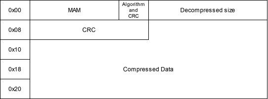
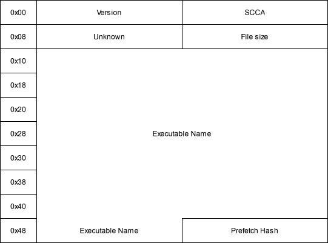
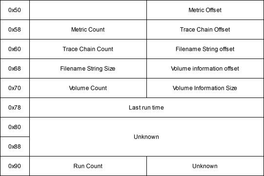
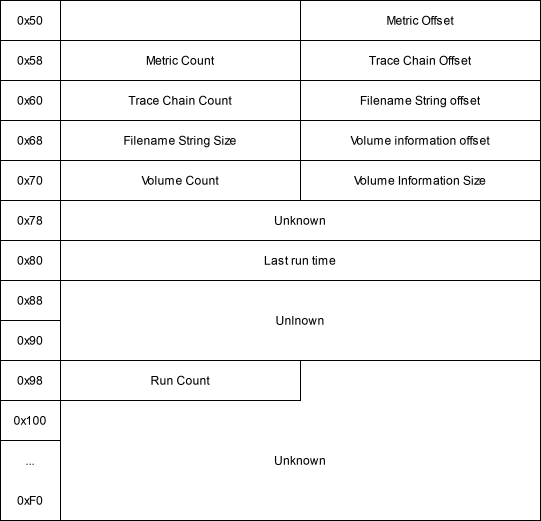
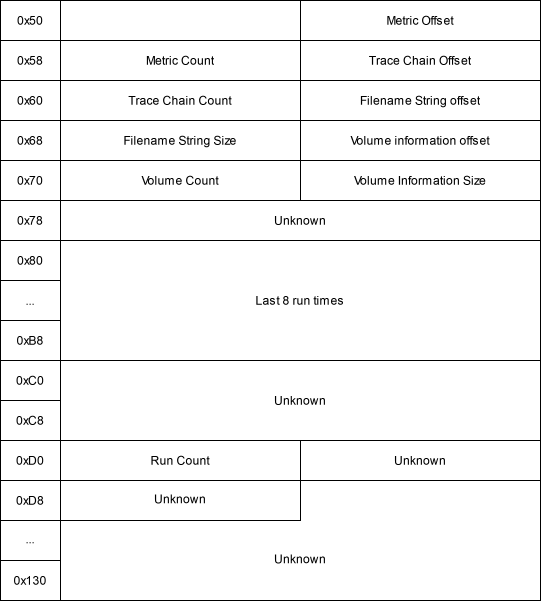
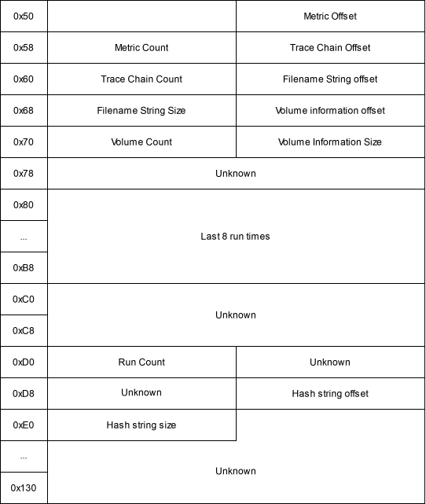
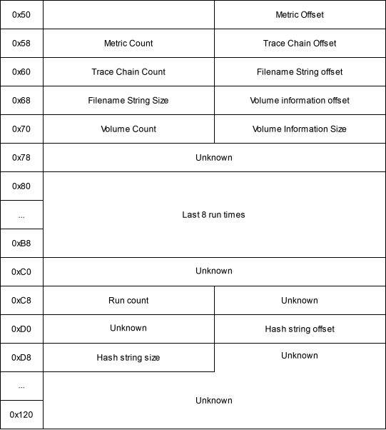

# ys-prefetch-parser

Yamato Security's maintained fork of Samuel Garcés Marín's
[frnsc-prefetch](https://github.com/ForensicRS/frnsc-prefetch) crate, the Windows Prefetch (`.pf`)
parser used by [Juntei](https://github.com/Yamato-Security/juntei). The complete upstream history and
the MIT license are retained; everything below this section is upstream's README.

frnsc-prefetch was chosen after comparing the Rust prefetch parsers with libscca (libyal's reference
implementation) on 700 public samples (the artemis, frnsc-prefetch and prefetch-forensic test data):

| Crate | Format versions | Matches libscca | Damaged files | Notes |
| --- | --- | --- | --- | --- |
| frnsc-prefetch 0.13.4 | 17, 23, 26, 30, 31 | 695 of 696 (1 MB size limit) | 163 panics, 27 aborts in 58,000 | Metrics with flags, trace chains, file references, directory strings; `unsafe` transmutes |
| artemis (module) | 23, 26, 30, 31 | 694 of 696 (no version 17) | none | Part of a large application; no trace chains or file references |
| prefetch-core 0.1.1 | 30, 31 | 536 of 696 (versions 30 and 31 only) | none | Run count, run times, volumes, file names only |
| libprefetch 0.1.1 | 17, 23, 26 | parses 160 of 696 (no MAM decompression) | 308 panics, 26 aborts in 58,000 | Last run time only; unmaintained since 2018 |

The fork fixes what the comparison found and adds what the others had (file references, hash):

| Change | Source |
| --- | --- |
| No `unsafe`: strings were read by transmuting `&[u8]` to `&[u16]` | fork |
| Damaged files no longer panic or abort (every offset, count and size is checked; allocations are bounded) | fork |
| Files up to 64 MiB are read (a 1,000,188-byte Windows 8.1 file was rejected) | fork |
| Xpress Huffman / LZ77 decompression bounded and fixed; LZ77 and LZNT1 were routed to the wrong decoders | fork |
| `read_prefetch_bytes(name, &[u8])` parses files held in memory | fork |
| Prefetch hash, header file size and per-file NTFS file references | fork (fields from libscca / libprefetch / artemis) |
| The file-name hash check parses hex (it raised a notification for every file) | fork |
| `executable_path()` matches whole file names and resolves names truncated to 29 characters | fork |
| No printing to stdout from the library | fork |
| Tests: libscca parity for 16 samples, damaged files with an allocation limit | fork (samples from artemis, MIT) |

Use it from Cargo by commit:

```toml
frnsc-prefetch = { git = "https://github.com/Yamato-Security/ys-prefetch-parser", rev = "<commit>" }
```

```rust
use frnsc_prefetch::prelude::*;
let data = std::fs::read("./artifacts/30/C/Windows/Prefetch/CMD.EXE-6D6290C5.pf").unwrap();
let prefetch = read_prefetch_bytes("CMD.EXE-6D6290C5.pf", &data).unwrap();
println!("{} ran {} times", prefetch.executable_path(), prefetch.run_count);
```

The crate keeps the name `frnsc-prefetch` and is not published to crates.io; its versions start at
0.14.0 and are the fork's own. See [CHANGELOG.md](CHANGELOG.md).

---

# Prefetch Parser

[](https://crates.io/crates/frnsc-prefetch) [](https://docs.rs/frnsc-prefetch) [](https://github.com/ForensicRS/frnsc-prefetch/blob/main/LICENSE) [](https://github.com/ForensicRS/frnsc-prefetch/workflows/Rust/badge.svg?branch=main)

A pure rust parser implementation of the windows prefetch. Works on all platforms.

```rust
use forensic_rs::prelude::*;
use frnsc_prefetch::prelude::*;
let mut fs = ChRootFileSystem::new("./artifacts/17", Box::new(StdVirtualFS::new()));
let prefetch_list : <PrefetchFile> = read_prefetch_form_fs(&mut fs).expect("Must read all prefetch from filesystem");
```

### Into Timeline

A PrefetchFile structure can be converted into [*TimelineData*](https://github.com/ForensicRS/forensic-rs/blob/main/src/traits/forensic.rs) be carefull as a single prefetch can be larger than 45Kb and in the process some data is lost like the MFT file references or the file traces.
```
{ 
    time: 06-11-2023 14:18:00.429, 
    artifact: Unknown, 
    fields: {
        "artifact.host": "", 
        "artifact.name": "Unknown", 
        "artifact.tenant": "", 
        "file.accessed": 06-11-2023 14:18:00.429, 
        "file.path": "POWERSHELL.EXE", 
        "pe.imports": ["\\VOLUME{01d98a6b8e4b1a36-1c2ea44d}\\WINDOWS\\SYSTEM32\\NTDLL.DLL", "\\VOLUME{01d98a6b8e4b1a36-1c2ea44d}\\WINDOWS\\SYSTEM32\\WOW64.DLL", "\\VOLUME{01d98a6b8e4b1a36-1c2ea44d}\\WINDOWS\\SYSTEM32\\WOW64WIN.DLL", "\\VOLUME{01d98a6b8e4b1a36-1c2ea44d}\\WINDOWS\\SYSTEM32\\KERNEL32.DLL", "\\VOLUME{01d98a6b8e4b1a36-1c2ea44d}\\WINDOWS\\SYSWOW64\\KERNEL32.DLL", "\\VOLUME{01d98a6b8e4b1a36-1c2ea44d}\\WINDOWS\\SYSTEM32\\USER32.DLL", "\\VOLUME{01d98a6b8e4b1a36-1c2ea44d}\\WINDOWS\\SYSTEM32\\WOW64CPU.DLL", "\\VOLUME{01d98a6b8e4b1a36-1c2ea44d}\\WINDOWS\\SYSWOW64\\NTDLL.DLL", "\\VOLUME{01d98a6b8e4b1a36-1c2ea44d}\\WINDOWS\\SYSWOW64\\WINDOWSPOWERSHELL\\V1.0\\POWERSHELL.EXE", "..."], "prefetch.execution_times": 2945, 
        "prefetch.version": 30, 
        "prefetch.volume_files": ["\\VOLUME{01d98a6b8e4b1a36-1c2ea44d}\\$EXTEND", "\\VOLUME{01d98a6b8e4b1a36-1c2ea44d}\\PROGRAM FILES", "\\VOLUME{01d98a6b8e4b1a36-1c2ea44d}\\PROGRAM FILES\\SECRMM", "\\VOLUME{01d98a6b8e4b1a36-1c2ea44d}\\PROGRAM FILES\\SECRMM\\ADMINUTILS", "\\VOLUME{01d98a6b8e4b1a36-1c2ea44d}\\PROGRAM FILES\\SECRMM\\ADMINUTILS\\SDK", "\\VOLUME{01d98a6b8e4b1a36-1c2ea44d}\\PROGRAMDATA", "..."]
        } 
    }, 
    time_context: Accessed 
}
```

```rust
let mut fs = StdVirtualFS::new();
let file = fs.open(Path::new(
    "./artifacts/30/C/Windows/Prefetch/POWERSHELL.EXE-AE8EDC9B.pf",
)).unwrap();
let pref = read_prefetch_file_compressed("POWERSHELL.EXE-AE8EDC9B.pf", file).unwrap();
let mut forensic_data = pref.timeline();
let event : TimelineData = forensic_data.next().unwrap();
```

### Into Activity

Transforms a prefetch data into a user activity event in order to know which program the user executed.

`ForensicActivity { timestamp: 06-11-2023 15:18:00.237, user: "WARD", session_id: Unknown, activity: ProgramExecution(\VOLUME{01d98a6b9e4a0a35-1c9e547d}\WINDOWS\SYSWOW64\WINDOWSPOWERSHELL\V1.0\POWERSHELL.EXE) }`

```rust
let mut fs = StdVirtualFS::new();
let file = fs.open(Path::new(
    "./artifacts/30/C/Windows/Prefetch/POWERSHELL.EXE-AE8EDC9B.pf",
)).unwrap();
let pref = read_prefetch_file_compressed("POWERSHELL.EXE-AE8EDC9B.pf", file).unwrap();
let mut forensic_data = pref.activity();
let activity : ForensicActivity = forensic_data.next().unwrap();
```

### Prefetch Format

The references can be found here: [libscca](https://github.com/libyal/libscca/blob/main/documentation/Windows%20Prefetch%20File%20(PF)%20format.asciidoc)

The file format when it's compressed has a MAM signature, followed by the compression algorithm a flag that indicates if it has CRC, the decompressed size, the CRC value and finally the compressed size:



The decompressed file (or the full file when its not compressed) has a header:

* version: The SCCA version used to generate the prefetch.+
    * 17: Windows XP
    * 23: Windows 7
    * 26: Windows 8.1
    * 30: Windows 10
* signature: The signature is "SCCA"
* File Size: The prefetch file size
* Executable name: Name of the executable for which this prefetch was created
* Hash: the prefetch hash. Must be the same as the one in the prefetch file name.



After the header comes version-dependent file information data:

* Positions of the metric data: used to know which DLLs/EXEs loaded the executable.
* Positions of the trace chain
* Location of the strings array
* Location of the volume information array
* Number of executions
* Last execution time: in FILETIME format. For modern versions the last 8 times are stored.









